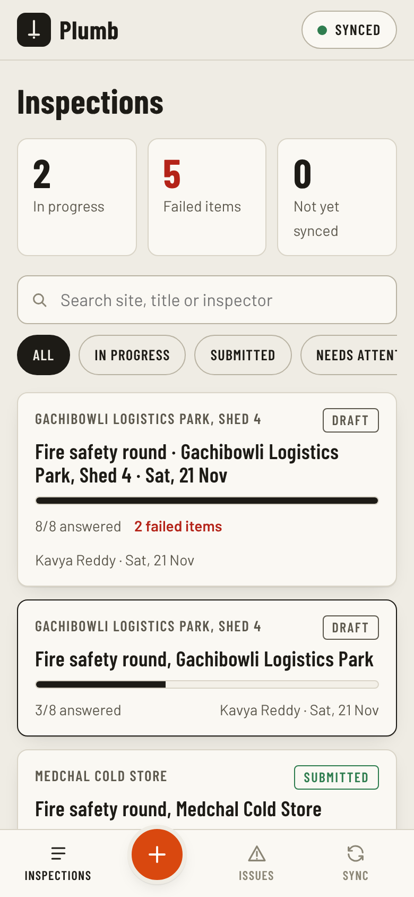
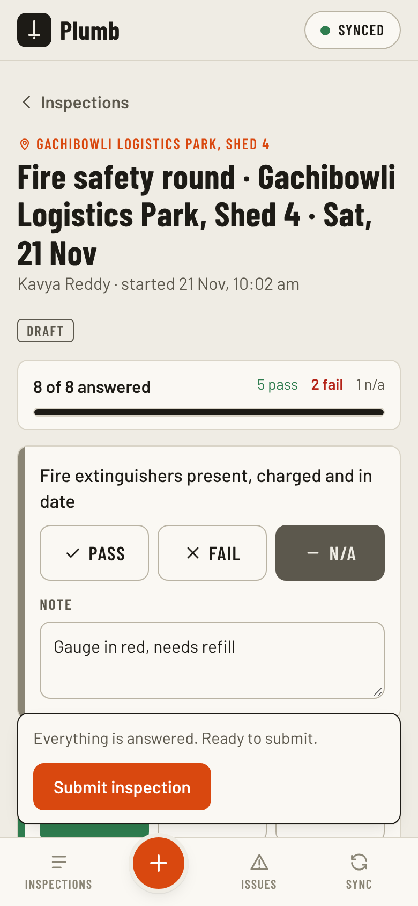
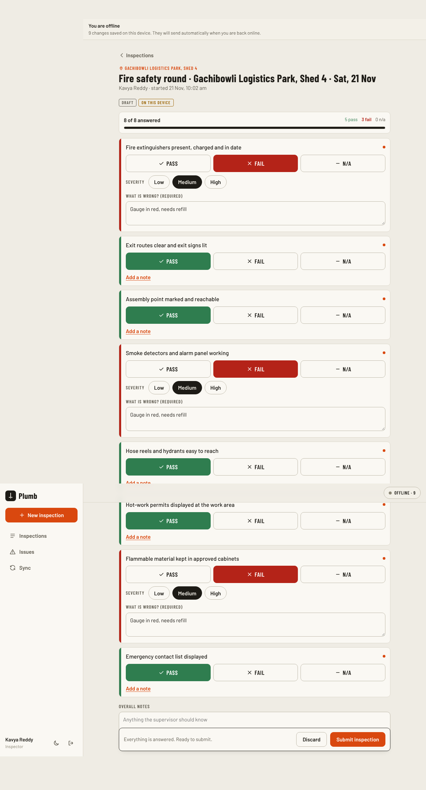
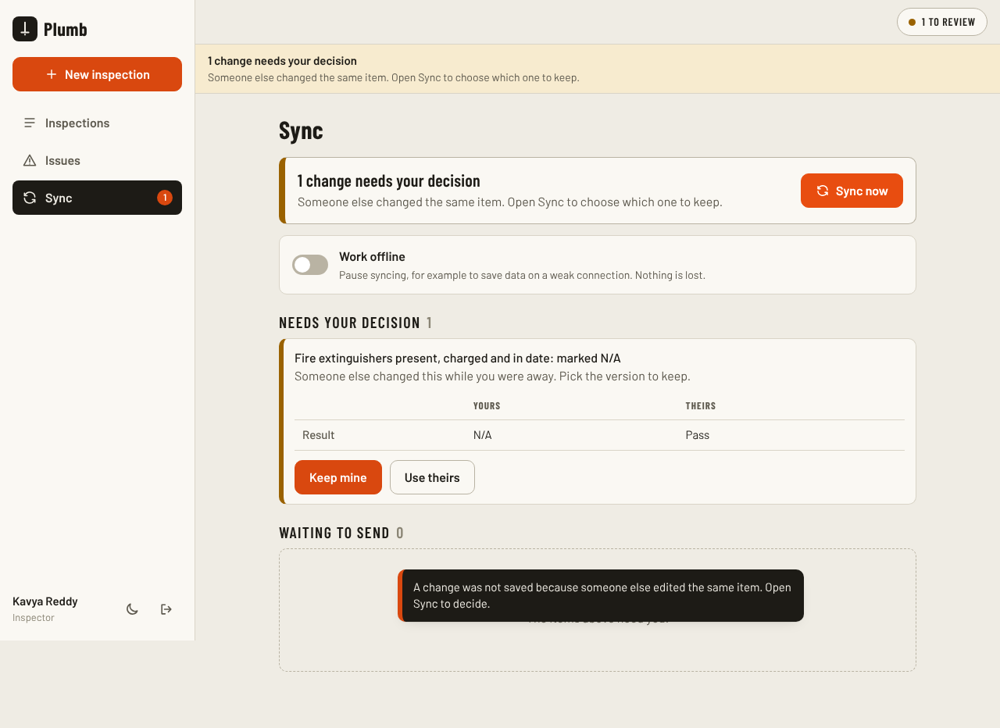

# Plumb: offline-first field inspections

A site-safety inspection app that keeps working when the signal drops. Inspectors walk a site, mark each checklist item Pass / Fail / N/A, add notes, and submit. Everything is saved on the device first and syncs when the connection returns. If two people edit the same item, nobody's work is silently lost.

| | |
|---|---|
| Front end | React 18, Vite, React Router (no UI library, hand-written CSS) |
| On-device storage | IndexedDB (small hand-written wrapper) + a service worker for the app shell |
| Back end | FastAPI, raw SQL with psycopg2, JWT + bcrypt |
| Database | PostgreSQL (Neon in production) |
| Hosting | Vercel (static front end + one Python function) |







## Demo logins

| Role | Email | Password |
|---|---|---|
| Supervisor | saisathvik@gmail.com | Admin@123 |
| Inspector | kavya.reddy@gmail.com | Field@1234 |
| Inspector | ramesh.yadav@gmail.com | Field@1234 |

(`farhan.ali@` and `lakshmi.prasad@gmail.com` also exist, same password as the inspectors.)

## Run it on your computer (Windows PowerShell)

You need Python 3.11+, Node 18+, and PostgreSQL running locally.

```powershell
# 1. Back end (terminal 1), from the project folder
python -m venv .venv
.venv\Scripts\Activate.ps1
pip install -r backend\requirements.txt
$env:DB_PASSWORD = "your-postgres-password"
cd backend
python seed.py            # creates the plumb_dev database, tables and demo data
python -m uvicorn main:app --port 8000

# 2. Front end (terminal 2)
cd frontend
npm install
npm run dev               # open http://localhost:5173
```

To use a Neon database instead, set `$env:DATABASE_URL = "postgresql://..."` before `python seed.py`.

## Try the offline behaviour

1. Sign in as Kavya and open an inspection.
2. In Chrome DevTools, Network tab, choose **Offline** (or use the **Work offline** switch on the Sync page).
3. Mark items, add notes, start a new inspection. The pill at the top shows *Offline · N* and your changes stay on the device. Reload the page: it still opens.
4. Go back online. The changes send by themselves and the pill returns to *Synced*.
5. To see a conflict: open the same inspection in a second browser profile, change an item online, then change the same item offline in the first one and reconnect. The Sync page lets you choose **Keep mine** or **Use theirs**.

(The service worker only runs in a production build: `npm run build` then `npm run preview`.)

## How sync works

The device keeps, per inspection, the last copy the server confirmed plus a queue of changes ("ops") made since. The screen shows the server copy with the queued changes applied on top.

`POST /sync` carries up to 50 ops and a cursor, and returns one result per op plus whatever changed on the server since the cursor.

| Op result | Meaning |
|---|---|
| `applied` | Saved. The device drops it from the queue. |
| `conflict` | Someone else changed the same field after the version this change was based on. The server copy is returned and the person decides. |
| `rejected` | The server refused it (already submitted, missing note, not allowed). The reason is shown on the Sync page. |

**Idempotency.** Every op has a client-made `op_id`. The server records each one in `sync_ops`; a repeated `op_id` (a retry after a dropped connection) returns the stored answer instead of applying the change twice. Each op runs in its own transaction, so one bad op cannot block the ones behind it.

**Conflicts.** Versions are tracked per field group (an item's result+severity, an item's note, an inspection's title, its notes). Changes to different groups merge. The same client's own stale, chained changes are not conflicts. Identical values are not conflicts. Submitted inspections are locked.

**Retries.** On a network error, 5xx or 429 the app retries after 2 s, 4 s, 8 s … up to 60 s (with a little randomness). A 401 stops syncing, keeps the data and asks the person to sign in again. Going back online, returning to the tab, or pressing *Sync now* retries at once.

**Status messages** are written for the person using the app ("You are offline. 3 changes saved on this device…"), not for developers.

## Tests

```powershell
# Back end (uses its own plumb_test database; refuses to run if DATABASE_URL is set)
cd backend
pip install -r requirements-dev.txt
$env:DB_PASSWORD = "your-postgres-password"
python -m pytest -q       # 45 tests

# Front end
cd frontend
npm test                  # 31 tests
```

Back end: login and lockout, idempotent replay, poison-pill ops, conflicts and merges, locking, submit rules, paging, DB reset, replaying a whole offline session. Front end: backoff timing, retry after network / 5xx / 429, 401 handling, pause, batching, queue joining, conflict choices, persistence across reload, status wording.

## Deploy: Neon + Vercel

1. **Neon**: create a project, copy the connection string (starts with `postgresql://`).
2. **GitHub**: push this folder to a repository.
3. **Vercel**: import the repository. Leave the framework preset as *Other*; `vercel.json` already sets the build. Add environment variables:
   - `DATABASE_URL` = the Neon string (no quotes)
   - `JWT_SECRET` = a long random text
   - `SEED_DEMO` = `0` if you want only the supervisor account and no demo data
4. Deploy. The first request creates the tables (and demo data unless `SEED_DEMO=0`).

## Troubleshooting

- **"Database is not ready" (503)**: `DATABASE_URL` is missing or wrong on Vercel. It must start with `postgresql://`.
- **"password authentication failed" locally**: set `$env:DB_PASSWORD`.
- **App does not open offline**: use a production build (`npm run preview`) and load it once online first.
- **Data looks stale after redeploying**: close all tabs of the app once so the new service worker takes over.

## Known limits

- Photos and attachments are not supported.
- Only the title and overall notes of an inspection can be edited after it starts; checklist wording is fixed per template.
- The service worker caches the app, not API data; inspection data lives in IndexedDB. Clearing site data on a device removes unsynced changes.
